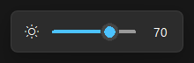

# aula-knob

Custom actions for the volume knob on an **AULA F75 Max** keyboard connected over Bluetooth, on Windows.

Right now: **Ctrl + knob changes monitor brightness** (DDC/CI). A Windows 11-style pop-up shows the level. Without Ctrl, the knob still controls volume.



## Requirements
- Windows 10/11, Python 3.10+ (standard library only, no `pip install`)
- An external monitor with **DDC/CI enabled** in its on-screen menu

## Run
```
pythonw aula_knob.py          # background, no console
python  aula_knob.py --debug  # console with log, Ctrl+C to quit
```
Change `STEP` in `aula_knob.py` to adjust the brightness change per click (default 5%). Only one instance runs at a time.

## How it works
- A low-level keyboard hook (`WH_KEYBOARD_LL`) watches for `VK_VOLUME_UP` / `VK_VOLUME_DOWN`. While Ctrl is held, those keys are swallowed so the volume doesn't change, and brightness is stepped instead.
- Brightness is written with `dxva2` `SetMonitorBrightness` on a worker thread. Fast spins are combined into one write, because each DDC/CI write takes about 50 ms.
- `osd.py` draws the pop-up with tkinter. It follows the light/dark theme, accent colour and DPI. It is click-through, never takes focus and fades out after 1.2 s.
- Note: the hook can't tell which device a key came from, so Ctrl + Volume Up/Down from *any* device changes brightness.

## Findings about the keyboard
- Over Bluetooth LE it reports **VID `05AC` / PID `024F`** (an Apple ID).
- HID collections: keyboard, mouse, consumer control (`MI_02&Col01`), system control, multi-axis, and vendor pages `0xFF60/0x61` (the usual QMK/VIA raw-HID usage), `0xFF59/0x61` and `0xFFFF/0x01`.
- The knob sends consumer-control reports: right `01 e9 00` (Volume Up), left `01 ea 00` (Volume Down), then a `01 00 00` release about 10 ms later.
- In the keyboard's on-screen menu, the knob sends **nothing** to the PC on any channel.

## tools/
Read-only helpers used to work out the above:
- `knob_listen.py [seconds]`: logs consumer-control HID reports (with the source device) and media/volume key events.
- `knob_listen_all.py [seconds]`: the same for every AULA HID collection, vendor pages included. Keyboard and mouse collections are excluded.
- `ddc_probe.py`: prints each monitor's DDC/CI brightness.
- `osd_preview.py [value]`: shows the pop-up for a few seconds.
